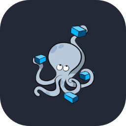
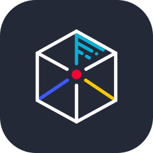
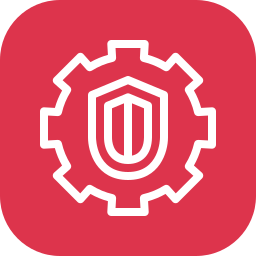
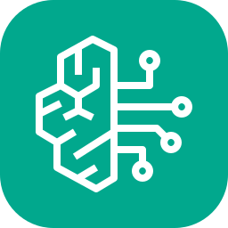

<!-- ───────────────────────────── Header ───────────────────────────── -->
<p align="center">
  
</p>


### Hi, I'm Shaurya

**Cloud & DevOps Engineer** — AWS · Infrastructure as Code · CI/CD · DevSecOps

I like turning manual work into code: infrastructure in Terraform, apps in containers, releases through pipelines, and security checks built into every stage. Most of what I know comes from building projects, breaking them, and fixing them — and I'm always experimenting with something new.

- **Build** — secure, scalable infrastructure on AWS
- **Automate** — provisioning, deployments and everything in between
- **Secure** — scanning and threat detection, shifted left

<br clear="right">

## Tech Stack

<table align="center">
  <tr>
    <td width="50%" valign="top">
      <sub><b>CLOUD</b></sub><br>
      
    </td>
    <td width="50%" valign="top">
      <sub><b>INFRASTRUCTURE AS CODE</b></sub><br>
      
    </td>
  </tr>
  <tr>
    <td valign="top">
      <sub><b>CONTAINERS</b></sub><br>
      
      
    </td>
    <td valign="top">
      <sub><b>OPERATING SYSTEMS</b></sub><br>
      
    </td>
  </tr>
  <tr>
    <td valign="top">
      <sub><b>CI/CD &amp; VERSION CONTROL</b></sub><br>
      
      
      
      
    </td>
    <td valign="top">
      <sub><b>SECURITY</b></sub><br>
      
      
      
    </td>
  </tr>
  <tr>
    <td valign="top">
      <sub><b>DEVELOPMENT</b></sub><br>
      
      
      
      
      
    </td>
    <td valign="top">
      <sub><b>AI</b></sub><br>
      
      
    </td>
  </tr>
</table>

## Currently Exploring

```yaml
exploring:
  - cloud-architecture   # designing for scale, resilience and cost
  - automation           # less clicking, more pipelines
  - devsecops            # security baked into every stage
  - advanced-aws         # networking, IAM and managed services in depth
```

## GitHub Stats

<p align="center">
  
  
</p>

## Connect With Me

<p align="left">
  <!-- TODO: add your LinkedIn handle, then move this line out of the comment
  <a href="https://www.linkedin.com/in/YOUR-LINKEDIN-HANDLE/"></a>&nbsp;
  -->
  <a href="mailto:shauryacs19@gmail.com"></a>&nbsp;
  <a href="https://github.com/shauryacs19"></a>
  <!-- Optional: add a portfolio / blog link here the same way -->
</p>

Open to collaborating on cloud, DevOps and automation projects — feel free to reach out.
